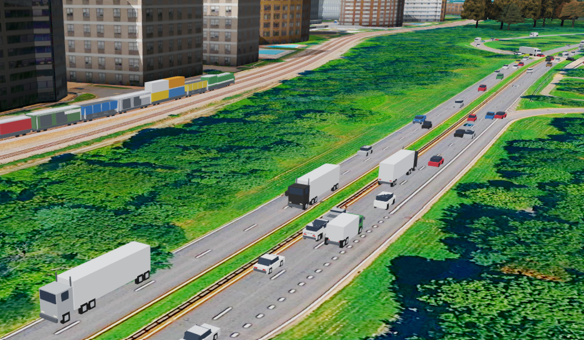
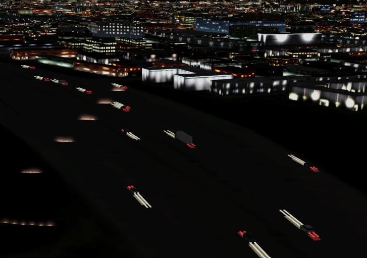
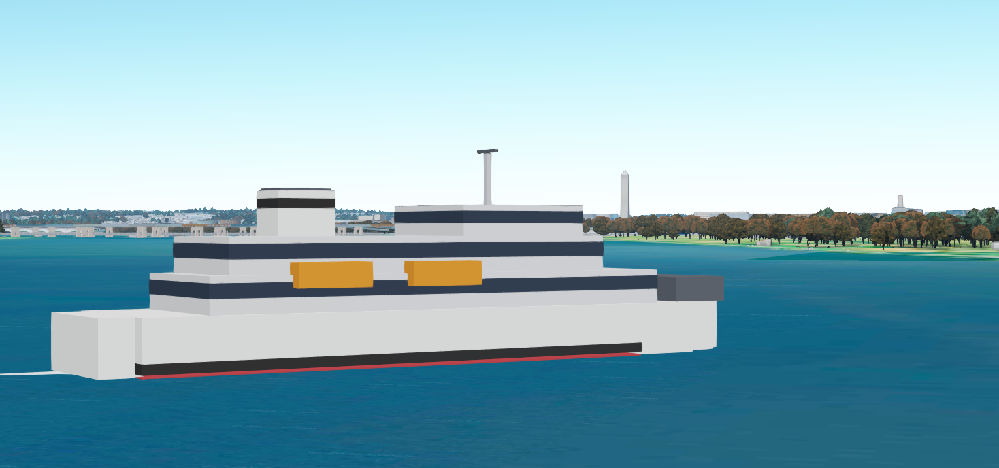
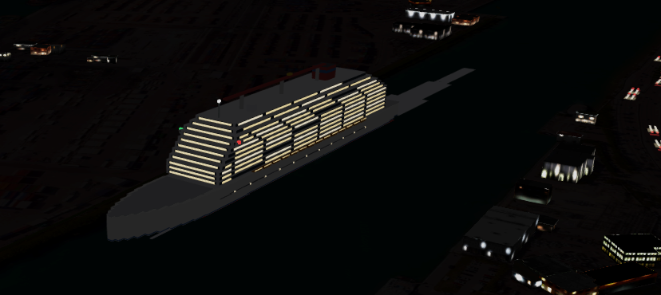
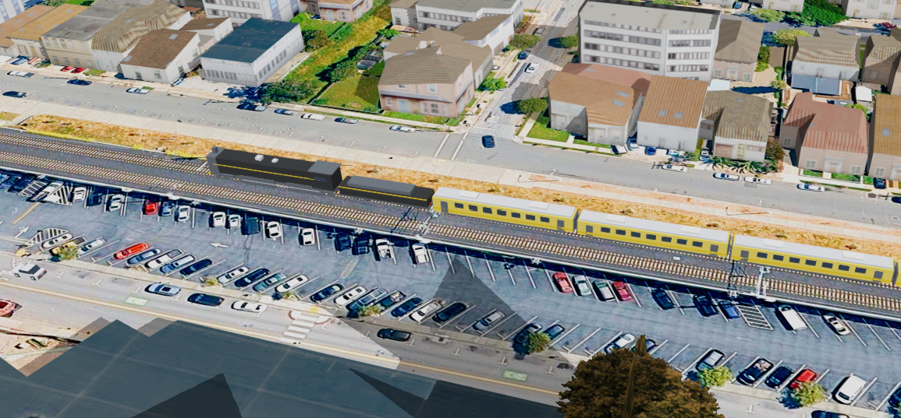

<h1 align="center">GeoFS Living World Addon</h1>

  <b>Beta</b> &nbsp;·&nbsp; Created by <b>SkyTeamDelta</b> &nbsp;·&nbsp; MIT License

  <a href="https://raw.githubusercontent.com/MVX-star/GeoFS-Living-World-Addon/main/GeoFS-Living-World-Addon.user.js"><b>Install the script</b></a>
  &nbsp;·&nbsp;
  <a href="https://github.com/MVX-star/GeoFS-Living-World-Addon/issues">Report a bug</a>

---

**GeoFS Living World** is an add-on that makes GeoFS feel more active and realistic by adding dynamic, geographically grounded traffic across the simulator.

From cars traveling along real-world road networks to trains moving across railway systems and boats navigating waterways, Living World adds movement and activity to the landscapes around you.

## Features

- 🚗 **Road Traffic**: Cars and trucks travel along real-world geographic roads, navigating routes and intersections.
- 🚆 **Rail Traffic**: Trains bring activity to railway networks across the world.
- 🚢 **Marine Traffic**: Boats travel across waterways, adding activity to rivers, lakes, and coastal areas.
- 🌍 **Geographic Realism**: Traffic is designed around real-world transportation networks and locations.
- 🔄 **Dynamic World**: Traffic loads and operates around your location, helping create a more active environment as you explore.

### And more

- **Rare vehicles**: supercars (more often in rich areas), cruise ships near real cruise ports, and famous trains in their own country or line (bullet trains, TGV, ICE, Acela, Glacier Express, and more). An optional yellow highlighter (off by default) points them out.
- **Night lighting**: headlights and tail lights, and lit windows on cruise ships.
- **Auto-Configure** (default): picks the radius and vehicle counts for where you are and the time of day. Switch to **Manual** any time to set everything yourself.
- **Model detail** Low / Regular / High, and an optional **Unlimited radius** for cars.

| Night traffic | Ferry | Cruise ship at night |
|:---:|:---:|:---:|
|  |  |  |

## Installation

1. Install the [Tampermonkey](https://www.tampermonkey.net/) browser extension.
2. Click to install the script: **[GeoFS-Living-World-Addon.user.js](https://raw.githubusercontent.com/MVX-star/GeoFS-Living-World-Addon/main/GeoFS-Living-World-Addon.user.js)**
3. Open [GeoFS](https://www.geo-fs.com). A **Living World** button appears in the bottom bar. Click it to open the menu.

Updates install automatically through Tampermonkey.

## Using the menu

| Tab | What it does |
|---|---|
| **Main** | On/off switch, Manual or Auto-Configure, and Model detail. |
| **Extra & Performance** | Traffic, map data, rare vehicles, calibration and boats. **If your frame rate drops, start here.** |

If cars or boats float above or sink into the ground or water, use the height offsets under *Calibration* and *Boats*.

## Notes and known limits

> [!NOTE]
> This is a **beta**. Please report problems.

- It needs access to the map servers (OpenFreeMap and Overpass). In some countries, including mainland China, these can be blocked or very slow. If nothing loads for a while, the menu says so, and a VPN may help.
- Large cities with 3D buildings are heavy for GeoFS by themselves. If it lags, try Low detail, or turn the addon off to compare.
- Vehicles hide above 15,000 ft above the terrain.
- Settings are saved per browser.

## Reporting a bug

Open an [issue](https://github.com/MVX-star/GeoFS-Living-World-Addon/issues) and include the version number shown in the menu, what you were doing, and where in the world you were. If something breaks, press `F12` and copy anything red from the **Console** tab.

## Credits

Map data © [OpenStreetMap](https://www.openstreetmap.org/copyright) contributors (ODbL), served by [OpenFreeMap](https://openfreemap.org) and [Overpass API](https://overpass-api.de). Menu style based on GeoFS After Dark by SkyTeamDelta.

## License

Released under the [MIT license](LICENSE).
